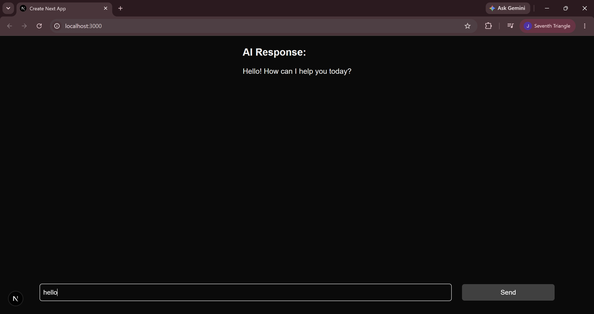
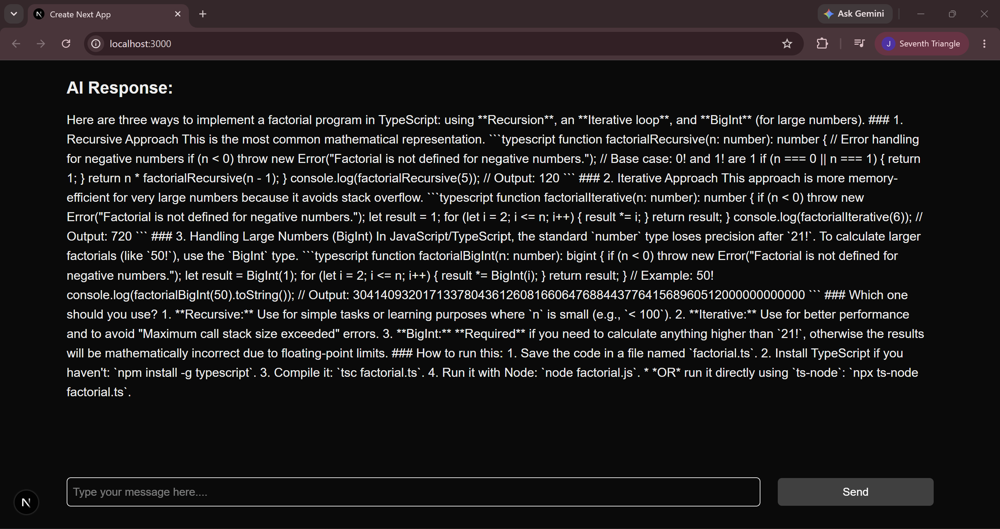
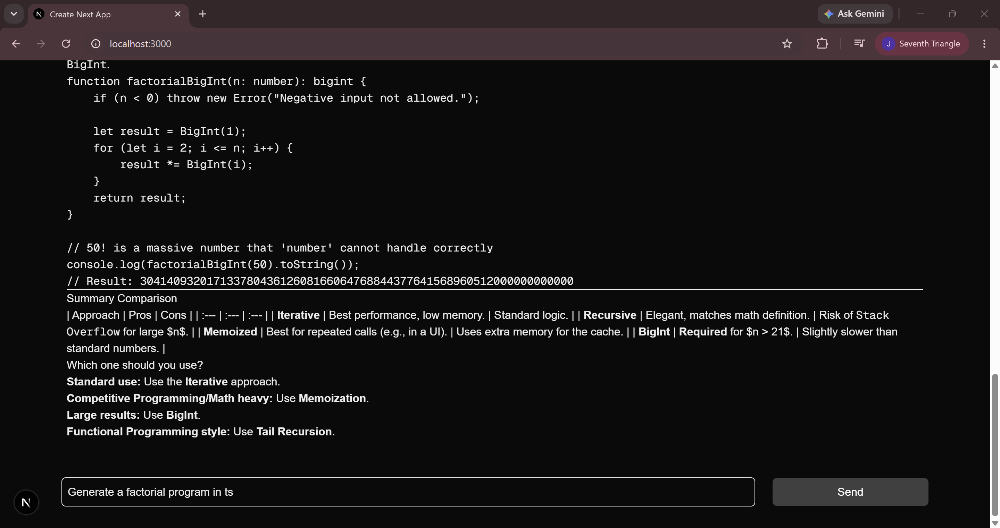

# AI Text Generator

A simple web app for sending a text prompt to Google's Gemini model and viewing the generated response. The interface is built with Next.js and renders response content as Markdown.

## Features

- Submit a prompt from the home page.
- Generate text with Google GenAI using the `gemini-3-flash-preview` model.
- Display the generated response with Markdown formatting.
- Use a dark-mode-aware interface styled with Tailwind CSS.

## Screenshots

### Home page



### AI response



### Structured response



## Tech stack

- [Next.js](https://nextjs.org/) 16 with the App Router
- [React](https://react.dev/) 19 and [TypeScript](https://www.typescriptlang.org/)
- [Tailwind CSS](https://tailwindcss.com/) 4
- [Google GenAI SDK](https://www.npmjs.com/package/@google/genai)
- [react-markdown](https://www.npmjs.com/package/react-markdown)

## Getting started

### Prerequisites

- Node.js and npm
- A Google GenAI API key

### Installation

1. Install the project dependencies:

   ```bash
   npm install
   ```

2. Create a `.env.local` file in the project root and add your API key:

   ```env
   GOOGLE_API_KEY=your_google_genai_api_key
   ```

   Keep this key private and do not commit it to source control.

3. Start the development server:

   ```bash
   npm run dev
   ```

4. Open [http://localhost:3000](http://localhost:3000) in your browser.

## Using the app

Enter a prompt in the input at the bottom of the page and select **Send**. The generated response appears above the input and is rendered as Markdown.

## Available scripts

| Command | Description |
| --- | --- |
| `npm run dev` | Start the Next.js development server. |
| `npm run build` | Create a production build. |
| `npm run start` | Serve the production build. Run `npm run build` first. |
| `npm run lint` | Run ESLint. |

## Project structure

```text
app/
  actions/
    ai.actions.ts   # Server action that requests a Gemini response
  globals.css       # Global styles and Tailwind CSS import
  layout.tsx        # Root layout and page metadata
  page.tsx          # Prompt input and response display
public/
  Home.png
  Response.png
  StructuredResponse.png
```

## Project history

The Git history shows the project evolving from the initial Next.js scaffold into an AI text generator:

- Added a server action to call Google GenAI.
- Replaced the starter page with a prompt input and Send button.
- Added Markdown rendering for generated responses.
- Refined the app structure and added the screenshots shown above.
